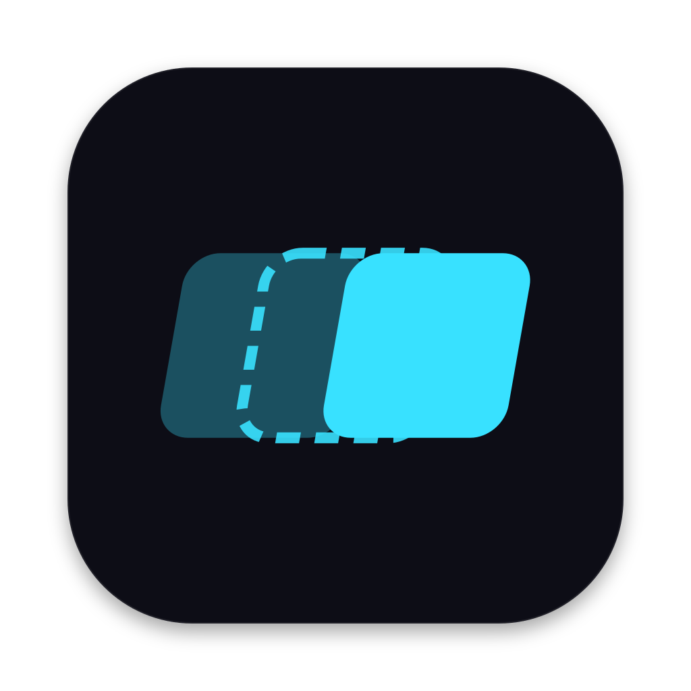

  

<h1 align="center">Smooth60</h1>

<b>Frame generation for console gameplay on Mac.</b> 
Plug a PS5 (or any console) into a USB capture card and Smooth60 turns 30 fps games into smooth 60 fps — or 120 fps — on your Mac, in real time.

---

## What it does

- **Frame generation** — creates a new frame between every pair of real ones with Apple's low-latency frame interpolation (VideoToolbox), so a 30 fps game plays at **60 fps** (2×) or **120 fps** (4×). It pauses automatically when the game already runs above ~40 fps.
- **Upscaling** — MetalFX, Apple's real-time game upscaler, takes 1080p up to **1440p or 4K** (60 fps mode).
- **Enhancement** — Light / Medium / Strong: sharpening and colour, plus Apple's temporal noise filter to clean up capture noise and shimmer. Optional **HUD & subtitle protection** keeps corners and subtitles untouched.
- **Sound in sync** — plays the capture card's game audio delayed by exactly the same amount as the picture.
- **Record & screenshot** — MP4 recordings and PNG screenshots of the processed picture (F8 / F7).
- **Stream output window** — a clean, video-only window for Window Capture in Streamlabs or OBS.
- **Before / After** — split view with a draggable divider: original capture on the left, Smooth60 on the right.
- **Live stats** — output fps, 1% low, latency, per-stage processing time and load.
- **4K / 1440p capture cards** — frames are scaled to 1080p for frame generation (Apple's limit) and can be upscaled back with MetalFX.

## Requirements

- A Mac with **Apple silicon** (M1 or later)
- **macOS 26** or later
- A **USB (UVC) capture card**, e.g. Elgato, Kreo Lynx, or most "plug and play" HDMI capture sticks
- For PS5: turn **HDR off**. 1080p output gives the best results.

## Install

1. Download the latest **Smooth60-x.y.dmg** from [Releases](../../releases).
2. Open it and drag **Smooth60** into **Applications**.
3. The app isn't notarised yet, so the first time macOS may refuse to open it:
   **System Settings → Privacy & Security → scroll down → Open Anyway**.
4. Allow **Camera** and **Microphone** access — that's how macOS lets apps read a capture card's picture and sound.

## Use

1. Connect the console's HDMI to the capture card and the card to the Mac.
2. Open Smooth60, pick your capture card in the **Source** tab, and press **Start** (⌘↩).
3. Pick 60 or 120 fps in **Frame Gen**, and upscaling / enhancement in **Quality**.

| Shortcut | Action |
|---|---|
| ⌘↩ | Start / stop |
| ⌘G | Frame generation on / off |
| ⌘B | Before / After |
| ⌥⌘0–3 | Enhancement Off / Light / Medium / Strong |
| ⇧⌘O | Stream output window |
| F8 or ⌘R | Record |
| F7 or ⌘S | Screenshot |
| ⌃⌘F | Full screen (video only) |
| ⌘I / ⌥⌘I | Stats box / detailed stats over the video |

Recordings and screenshots go to **Desktop › Smooth60** by default (change it in the **Display** tab).

### Streaming with Streamlabs / OBS

Turn on **Stream output** in the top bar, then in Streamlabs or OBS add **macOS Screen Capture → Window → "Smooth60 Stream Output"**. Smooth60 plays the game sound itself; if your streaming app also captures the card's audio, set its sync offset to the **Latency** Smooth60 shows.

## Build from source

You need the Xcode Command Line Tools (`xcode-select --install`). Then double-click **Build.command** — it compiles `Sources/main.swift` with `swiftc`, signs the app ad-hoc, and installs it to Applications. **MakeDMG.command** packages `build/Smooth60.app` into a DMG in `dist/`.

Everything is in one Swift file using only Apple frameworks: AVFoundation, VideoToolbox (`VTFrameProcessor`, low-latency frame interpolation, temporal noise filter), MetalFX, Core Image and AppKit.

## Good to know

- Frame generation adds latency — the picture and sound are delayed (typically ~80–120 ms) so generated frames can be placed evenly. Great for watching, recording and streaming; competitive players may prefer it off.
- Generated frames can show artefacts around fast-moving edges, as with any frame interpolation.
- Apple's real-time frame interpolation accepts at most 1920×1080, so bigger inputs are scaled to 1080p first.
- 120 fps needs a fast chip; if the Mac can't keep up, Smooth60 drops to 60 fps automatically. Upscaling and clean-up also switch themselves off if they make the Mac fall behind.

## Credits

Inspired by [Veyra](https://github.com/Likely7/Veyra-NRVideo), the Windows frame-generation app for capture cards. Smooth60 is a separate Mac app written from scratch and shares no code with it.

Made by **Tanmay Subrata Ghorai**.

## License

[MIT](LICENSE)
